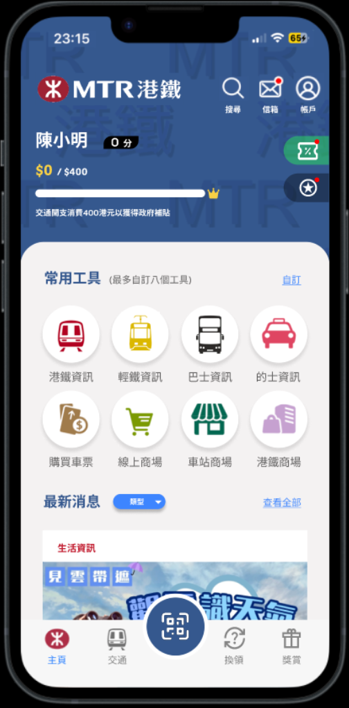
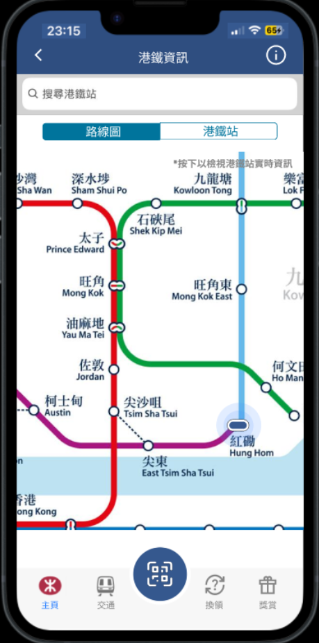
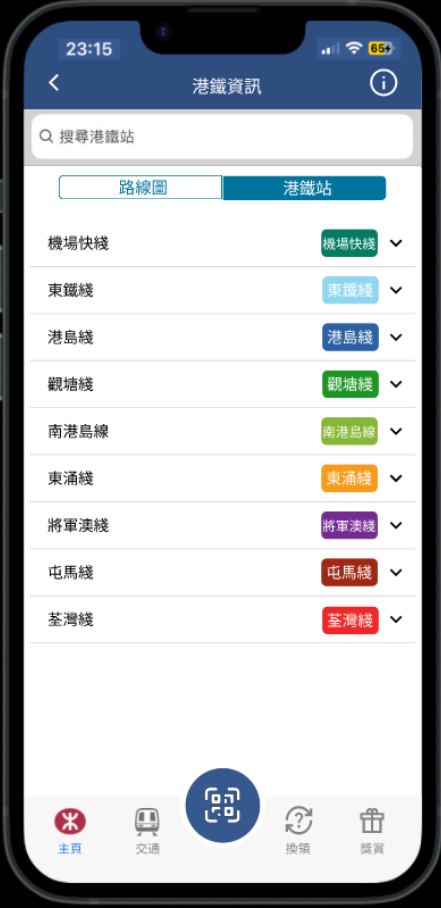
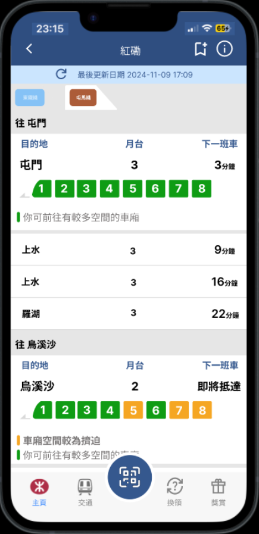
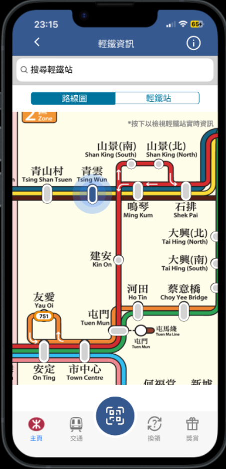
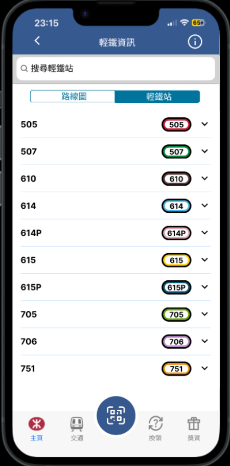
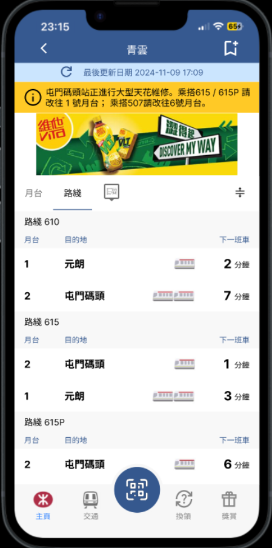
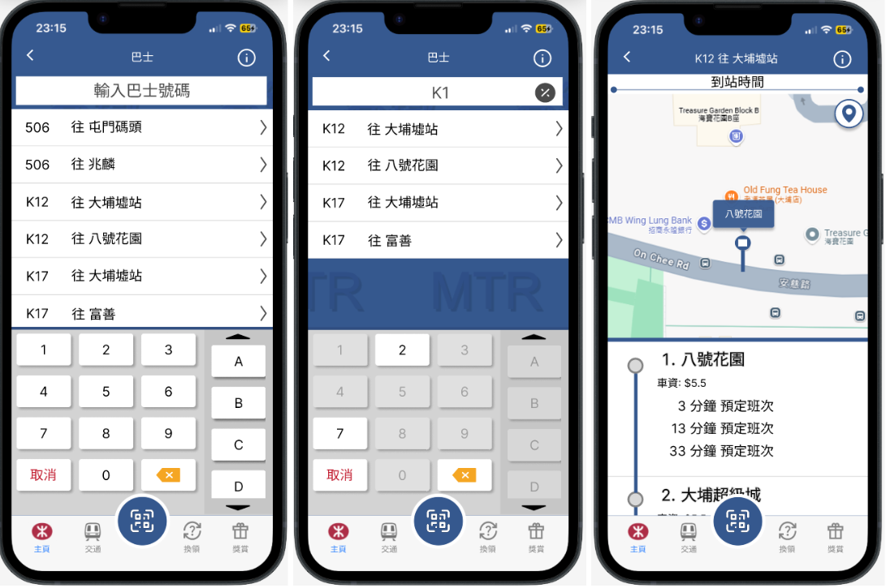

# MTR App Re-design

### A UX/UI redesign of the MTR Mobile app — clearer navigation, consistent language, and faster journey planning for Hong Kong commuters.

<p align="center">
  <a href="https://www.figma.com/proto/4PSn3fZJnAupaoeBiN1az0/Comp3423?node-id=6-3&p=f&t=gzm7Yh8gYQONEKOq-1&scaling=scale-down&content-scaling=fixed&page-id=0%3A1&starting-point-node-id=6%3A3"></a>
  &nbsp;
  <a href="https://t.maze.co/312790383"></a>
  &nbsp;
  
</p>

> **Disclaimer:** This is an independent student redesign for coursework. It is **not affiliated with, endorsed by, or connected to** MTR Corporation.

<p align="center">
  <b><a href="https://www.figma.com/proto/4PSn3fZJnAupaoeBiN1az0/Comp3423?node-id=6-3&p=f&t=gzm7Yh8gYQONEKOq-1&scaling=scale-down&content-scaling=fixed&page-id=0%3A1&starting-point-node-id=6%3A3">▶ Try the Interactive Prototype</a></b>
  &nbsp;·&nbsp;
  <b><a href="https://t.maze.co/312790383">▶ Take the Maze Usability Test</a></b>
</p>

---

## Preview



---

## Why redesign?

The official MTR Mobile app helps millions of people plan journeys, check real-time trains, and manage tickets. Through user research, several friction points stood out — especially around **Light Rail (LRT) discoverability**, **mixed-language UI**, **unclear interactive elements**, and **bus search accuracy**.

This project reimagines key flows so everyday commuting feels faster, clearer, and more trustworthy.

| Pain point | Redesign goal |
| --- | --- |
| Chinese mode still shows English labels | Full **language consistency** |
| Important tools buried; weak visual hierarchy | Clearer **home layout** & grouped actions |
| Map ovals / bars don’t look tappable | Buttons that **look like buttons** |
| No bottom nav on deep pages; missing platform tips | Persistent **navigation** + clearer **timetable cues** |
| One search bar mixes bus numbers & station names | Dedicated **bus-route keyboard** |

---

## What’s improved

### 1. Home — tools first, noise later
- Direct entry points for **港鐵 / 輕鐵 / 巴士**
- Related actions grouped (search, mail, account)
- Member points shown as a progress bar toward the transport subsidy
- Bottom nav with a prominent **QR ticket scan** action

### 2. MTR & LRT — maps you can actually use
- Interactive route maps with clear selected-station states
- Toggle between **路線圖** and station lists
- Route info screens with readable station lists
- Timetables with crowding colour tips and station image shortcuts (LRT)

### 3. Bus — type only what belongs
- Custom keypad limited to digits + route letters (A–D)
- Invalid next keys shown as translucent (disabled) hints
- Focused search results for routes like **K12 往大埔墟站**

---

## Design process

```
Research → Problem Finding → Usability Goals → Lo-fi UX → Hi-fi UI → Prototype → Maze Testing → Feedback
```

**Key principles applied**
- Topical organisation (group by transit mode)
- Proximity (related controls stay together)
- Consistency (shared nav, patterns, and language across screens)

---

## Try it yourself

| Resource | Link |
| --- | --- |
| **Figma prototype** | [Open interactive prototype](https://www.figma.com/proto/4PSn3fZJnAupaoeBiN1az0/Comp3423?node-id=6-3&p=f&t=gzm7Yh8gYQONEKOq-1&scaling=scale-down&content-scaling=fixed&page-id=0%3A1&starting-point-node-id=6%3A3) |
| **Maze usability test** | [https://t.maze.co/312790383](https://t.maze.co/312790383) |

### Suggested Maze tasks
1. Like a news post on Home, then open **港鐵資訊**
2. Explore the MTR map and check **Hung Hom** station
3. Return Home via the bottom navigation
4. Explore the LRT map and check **Tsing Wun** stop
5. Search bus **K12（往大埔墟站）** and inspect a stop

---

## User testing highlights

Remote testing was run on [Maze](https://t.maze.co/312790383) (shared Nov 15).

- High **task success rate** across all 5 scenarios
- Average task duration generally **under 15 seconds**
- Users praised **clear structure** and **consistent language / labelling**
- Follow-up improvements identified: enlarge Home **like** targets (fat-finger), and make bus-stop rows look more tappable (e.g. add a chevron)

---

## Screen gallery

### Home


### MTR Map


### MTR Route Info


### MTR Timetable


### LRT Map


### LRT Route Info


### LRT Timetable


### Bus Search & Arrival


---

## Developer

**YUE Lok Him**

Department of Computing, The Hong Kong Polytechnic University  
**COMP3423** Web Application Design and Development  
Group: **G14**

---

## License

This project is for **educational purposes only**, submitted as coursework for COMP3423.

Not affiliated with MTR Corporation. All MTR-related names and visuals are referenced solely for academic redesign purposes.

---

## Acknowledgments

- Department of Computing, The Hong Kong Polytechnic University
- COMP3423 Course Instructors
- [Flaticon](https://www.flaticon.com/) & [Google Fonts Icons](https://fonts.google.com/icons)
- Original reference: [MTR Mobile](https://apps.apple.com/hk/app/mtr-mobile/id369295276)

---

## Contact

For questions or suggestions: [lokhimworkemail@gmail.com](mailto:lokhimworkemail@gmail.com)

> **Note:** This is coursework. Some features shown in the prototype are simulated. A production environment would require full backend support.
